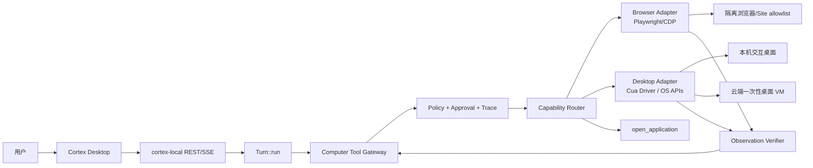

# Cortex Computer Use 目标架构

> 目标：本机、浏览器与云端具有同一套 Cortex 工具语义，但执行边界明确不同。

## 1. 设计原则

1. **Cortex 是控制平面。** 桌面驱动只观察和执行，不自行向模型开放 MCP 工具。
2. **策略先于模型。** 能力、应用 allowlist、敏感动作、审批寿命由代码决定。
3. **结构优先于像素。** API/CLI -> 浏览器结构化元素 -> OS accessibility tree
   -> 视觉坐标。
4. **一次观察授权一次动作。** frame id、element ref 和 window identity
   必须新鲜。
5. **执行后必须验证。** 每个动作批次产生新观察和可机器检查的 postcondition。
6. **所有能力可撤销。** feature flag、run lease、pause、cancel、kill 和
   driver watchdog 从第一阶段就有。
7. **同一 agent loop。** 本机和云端继续使用 `cortex-local` 的 `Turn::run`；
   变化的是 tool host，不是 agent 循环。

## 2. 组件图



建议边界：

```text
cortex-agent   工具规范、动作语义、Risk、审批请求、agent loop
cortex-local   本机 adapter 生命周期、host 执行、run lease、trace
cortex-proto   observation/action/status 的可选 wire DTO
app            onboarding、权限、应用策略、实时动作、暂停/接管/回放
cortex-agentd  云端桌面 placement 和生命周期（C4）
```

桌面驱动不要放在 `cortex-core` 或 `cortex-proto`；它们应保持无 OS 依赖。

## 3. 能力路由

模型看到的是 Cortex 工具，不是 Cua/MCP/Playwright 原始工具。

| 任务 | 首选通道 | 回退 |
|---|---|---|
| 已知 SaaS API/连接器 | MCP/API | 浏览器 |
| Cortex 内置浏览器页面 | Playwright/CDP + AX snapshot | 窗口截图 |
| 用户已登录的 Chrome 站点 | 显式授权的浏览器 daemon/extension + site rules | 原生窗口 AX/视觉 |
| 原生 Windows 应用 | UIA3/Win32 | window screenshot + 坐标 |
| 原生 macOS 应用 | AXUIElement/CGEvent/ScreenCaptureKit | window screenshot + 坐标 |
| 自绘/游戏/legacy | 窗口视觉 + 可选 OmniParser | 人工接管 |
| 启动应用 | `open_application` | 无 shell 回退 |
| 云端 GUI | 一次性桌面 VM | 不降级到用户本机 |

模型 prompt 必须明确“优先结构化通道”，工具目录只在该轮实际可用时出现。

## 4. 提议的工具协议

### 4.1 `computer_list`

只读观察系统的应用/窗口/显示器。

```json
{
  "include": ["apps", "windows", "displays"],
  "app_filter": "allowlisted"
}
```

返回稳定身份：

```json
{
  "frame_id": "f_01...",
  "displays": [{"id":"d1","bounds":{"x":0,"y":0,"w":1920,"h":1080},"scale":1.25}],
  "apps": [{"identity":{"kind":"windows_exe","publisher":"...","product":"...","binary":"chrome.exe"},
            "name":"Google Chrome","running":true}],
  "windows": [{"id":"w_...","app_id":"...","title":"...","focused":true,"secure":false}]
}
```

窗口标题可能含敏感信息，面向模型的最小结果应只返回用户/策略允许的部分。

### 4.2 `computer_observe`

```json
{
  "target": {"kind": "window", "id": "w_..."},
  "include": ["accessibility", "screenshot"],
  "max_nodes": 300
}
```

返回：

- `frame_id`
- app/window identity
- bounds、scale
- accessibility nodes（role/name/state/actions/ref）
- 可选 PNG
- OCR/视觉元素（可选）
- `secure_input` 状态

大树要分层展开。不要把整棵 UIA/AX 树原样塞入上下文；先按窗口、可见区域、
role 和任务过滤，并提供 `find` 能力。

### 4.3 `computer_act`

```json
{
  "frame_id": "f_...",
  "window_id": "w_...",
  "actions": [
    {"type":"click","target":{"ref":"e_17"},"button":"left"},
    {"type":"type","target":{"ref":"e_21"},"text":"..."}
  ],
  "verify": {
    "kind": "element_state",
    "ref": "e_21",
    "value_contains": "..."
  }
}
```

规则：

- 每个批次最多 3～5 个动作；
- `frame_id` 过期即拒绝并要求重新 observe；
- element ref 只在本 frame 有效；
- 坐标目标必须显式标记 `visual`，并带产生坐标的 frame id；
- 高风险动作不能与其他动作混批；
- 执行前验证 window、focus 和 secure input；
- 执行后自动 observe；
- `verify` 不通过时返回新 frame 和失败证据，不自动无限重试。

### 4.4 `computer_wait`

等待 UI 状态，而不是固定 sleep：

```json
{
  "window_id": "w_...",
  "until": {"kind":"element_present","role":"button","name":"保存"},
  "timeout_ms": 8000
}
```

### 4.5 `computer_handoff`

请求用户接管：

- secure field；
- CAPTCHA/MFA；
- UAC/系统权限；
- 高风险动作；
- 模型无法判断的隐藏状态；
- 用户主动暂停。

UI 应保留原窗口和当前 frame，避免用户从零开始。

## 5. 动作语义与 Risk

现有 `Risk::Safe/Write/Execute` 太粗。新增独立 `ComputerActionClass`，
不要强迫 shell 的 Risk 枚举承载桌面语义：

| class | 示例 | 默认策略 |
|---|---|---|
| observe | list/observe/screenshot | 每次 run 首次确认或按用户设置 |
| navigate | 滚动、切换 tab、普通文本 | allow within app policy |
| commit | 提交表单、保存 | confirm once per intent |
| transmit | 发送消息、上传文件、发布、提交外部数据 | 每次确认 |
| financial | 支付、转账、购买 | handoff，用户亲手完成 |
| destructive | 删除、清空、覆盖、卸载 | handoff 或强确认 |
| credential | 密码、验证码、银行卡、密钥 | deny automation，handoff |
| privilege | 安装、UAC、修改安全/网络设置 | handoff |
| persistent | Always allow app/site | 管理员可禁止，默认不提供 |

策略结果：

```text
Allow
ConfirmOnce
ConfirmEveryTime
HandoffToUser
Deny
```

模型不能把 `Allow` 解释成 `ConfirmEveryTime` 的替代。若本地 policy 返回
Handoff/Deny，Tool Gateway 不向驱动派发动作。

## 6. 应用识别与 allowlist

### Windows

- Packaged app：AUMID；
- 常规 exe：验证 Authenticode 发布者 + 产品名/版本 + 可选 binary name；
- 不使用文件名单独授权；
- 对未签名 exe 默认 deny；
- `application` 启动与应用内操作使用同一 identity。

### macOS

- bundle identifier；
- 验证 code signing team/designated requirement；
- TCC 权限由 Cortex app/稳定 helper 持有；
- Screen Recording 与 Accessibility 分别检测和引导。

### Linux

- desktop file id + executable path + AppArmor/portal 能力；
- X11 与 Wayland 分开报告；
- 未验证时只开放隔离浏览器，不宣称完整桌面。

策略层级：

```text
管理员 requirements（不可放宽）
  > 用户全局默认
  > 会话/任务授权
  > 单次批准
```

Block 永远优先于 Allow。保存的 Always allow 不能覆盖管理员限制。

## 7. 本机路径

### 7.1 生命周期

1. Desktop 启动/按需启动稳定 driver host；
2. 检查平台、版本、签名、TCC/UIA 能力和策略；
3. `/health` 返细粒度能力，不是单一 bool；
4. 每个 run 创建 lease，绑定 session、exec env、app policy；
5. 用户暂停/切走窗口/cancel 时撤销 lease；
6. run 结束、崩溃、睡眠恢复后清理输入状态和截图内存。

### 7.2 后台操作

后台输入是 C3 能力，不能默认视为安全：

- driver 需要稳定、可验证的 window/process target；
- 每次动作前重新验证窗口仍属于 allowlist；
- 后台输入失败时不得自动切换到前台坐标点击；
- 需要平台真实 CI harness 证明不会误投递到其他窗口；
- 多 agent 并发必须有 app/window lease，禁止同一窗口同时写。

### 7.3 用户可见性

- 顶栏显示 agent 正在观察/操作哪个应用；
- agent cursor 或目标元素高亮；
- “暂停 5 分钟 / 接管 / 停止”始终可用；
- 敏感动作 confirmation 显示目标 app、窗口、元素、文本摘要和是否离开本机；
- 截图预览在 confirmation 中可查看，确认按钮绑定该 frame hash。

## 8. 浏览器路径

### 默认隔离模式

- 新 Chromium profile；
- 无用户 cookie/password；
- 每个任务独立 context；
- site allowlist；
- 禁止 file/javascript/data URL；
- 上传/下载单独确认；
- 任务结束销毁 context。

### 用户已登录模式

- 用户明确进入；
- 扩展或本地 daemon 只暴露当前批准的 tab/site；
- 不向模型暴露 cookie、密码和 history；
- 跨 origin 导航重新检查 site policy；
- 输入密码/MFA 时立即 handoff。

Playwright 工具仍通过 Cortex 网关，元素 ref 绑定 snapshot/page/run，
避免旧 ref 点击新页面。

## 9. 云端路径

云端不能复用现有命令行沙箱的 boundary 作为 GUI 边界。建议：

```text
agentd placement
  -> 一次性 desktop VM
  -> Cortex local agent (container mode? local-in-vm mode)
  -> desktop driver inside VM
  -> no host desktop access
```

最低要求：

- 一任务一 VM（或至少一用户一会话一隔离快照）；
- 无用户本机文件、浏览器 profile、凭据；
- 只注入任务需要的最小 artifact；
- 网络默认 deny，按站点/host allowlist；
- 动作、截图、trace 在 VM 内产生并脱敏后回传；
- 任务完成/取消/超时后销毁；
- 支持 Windows VM 与 Linux VM 的明确 capability matrix；
- 成本超限可在不等待模型的情况下 kill。

该项在 C4 单独立项。若不能满足 VM 生命周期和网络隔离，不发布云端
computer use。

## 10. 数据与审计

每次 run 保存：

- policy version；
- app/site allowlist 与用户授权；
- observation frame hash 和脱敏后的 AX summary；
- action batch；
- confirmation preview/hash 和用户 decision；
- OS receipt；
- post-observation/verification；
- 最终 artifact 和应用状态证据。

默认不长期保存：

- 原始全屏截图；
- 用户输入的全部文字；
- AX secure value；
- cookie、token、密码；
- clipboard。

截图若用于回放，应先本地加密、设 TTL，并提供删除入口。企业场景可选择
完全不保存截图，只保存 hash 和结构化动作。

## 11. 失败与恢复

| 故障 | 行为 |
|---|---|
| frame 过期 | 拒绝动作，重新 observe |
| 目标窗口消失 | 停止，返回窗口列表和最后 frame |
| secure field | 立即 handoff |
| 输入驱动超时 | watchdog 释放所有键/按钮，标记 run failed |
| accessibility 树超时 | 本次使用窗口截图，不无限等待 |
| 用户切走窗口 | 前台模式暂停；后台模式重新验证 target |
| 页面跨 origin | 重新 site policy |
| 模型重复动作 | max-repeat + progress detector |
| 模型请求高权限 | policy deny/handoff，不执行后解释 |
| desktop agent 崩溃 | 宿主清理 lease、输入状态和临时 capture |

## 12. 兼容策略

第一阶段保留现有五个工具，但标记为 legacy：

- 旧客户端继续可用；
- 新客户端使用 `computer_list/observe/act/wait/handoff`；
- prompt 与 catalog 按 capability 选择；
- 新协议可选字段才能进入 `cortex-proto`；
- 稳定后再删除 legacy，不在同一个发布里同时修改 wire 与 UI。
