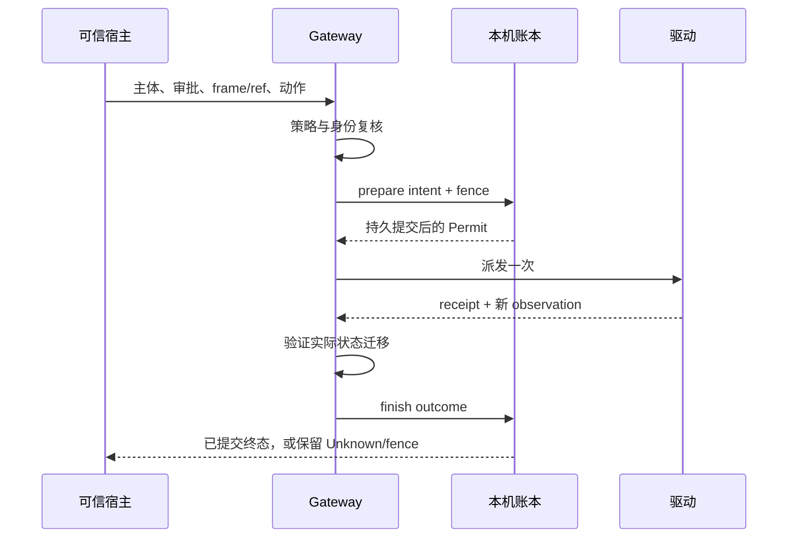

# 持久派发账本与审批关联接线契约

> 2026-11-08，Windows 本机主线。本文是待实现、待审查的接线契约。
> 当前主工作区尚无持久派发账本；`target/` 中独立候选模块不属于已上线能力。
> 独立核心已有 19 个测试和 2 个编译期测试通过；宿主关联候选仍未接持久 Permit，
> 普通会话的认证回归须先按 [18](18-ordinary-session-compatibility-2026-11-08.md) 修复。
> 四小时长跑继续绑定原源码，不能拿它证明本文新增接口已经通过验收。

## 为什么不能仅靠现有 trace

`computer_trace_gap` 的异步写入和缺口标记用于记录历史完整性，没有在每次驱动
调用前返回一个已持久提交的派发许可。`RunWriteGate` 约束本轮，窗口 lease
约束存活进程；进程退出后仍需保留的“这个操作可能已经执行”尚无独立权威记录。
Outbox 允许重放，不能直接用来排队电脑写动作。

最初版本的 `Turn` 调用 `ToolHost::computer` 只传工具名、参数和批准布尔值。
11 月 8 日的主线已加入私有构造的 `ComputerInvocation`，把宿主在询问前生成的
operation id 传给确认和执行，真实确认回执绑定工具及完整参数，进程内只消费一次。
11 月 9 日又通过 fake 模型/远端 + 真实 HTTP/LocalHost/Cua 的审批消费路径验证。
这部分仍是易失的宿主关联，不是持久 Permit；随机 `preview_hash` 只能标记一次
审计事件，不能当作跨重启的幂等键，也不能证明用户实际看过界面。

## 存储和核心接口

沿用 SQLx 0.9，独立 SQLite 本机账本。优先参考 Goose 的 session pool 装配，
以及 Cua 的 WriterLease、Windows AclLease；复制实现时保留版权和许可证来源。
`cortex-store` 是远端 Postgres 会话库，不作为本机派发事务的前置依赖。

候选核心接口为：

```text
prepare(Intent) -> Permit | Existing | Blocked
finish(Permit, Outcome)
```

创建、打开、prepare、finish 及最后一个 Ledger 的释放都是同步工作。
宿主适配必须把它们隔离到阻塞执行路径；不能只包装 prepare，却在 Tokio
任务或 UI 路径释放最后一个持有者并等待存储线程退出。

`Intent` 只接受可信宿主已经验证的主体 namespace、稳定操作 ID、审批关联 ID、
目标身份摘要及动作摘要。不得保存 bearer、确认 token、原始输入、截图、URL
或剪贴板。字段长度、版本和编码必须有边界。

约束如下：

- 主体与操作 ID 构成唯一键；同键改变动作、审批或目标摘要，返回冲突。
- 资源 fence 跨主体生效，同一资源不能因为切账号就获得第二个许可。
- 先在同一事务持久提交 intent 和 fence，再返回不可 Clone、不可序列化的
  `Permit`。SQL、提交、锁或损坏检查失败时不返回许可。
- 每个连接显式设置同步策略，使用持久事务；损坏库不能静默重建成空账本。
- 进程在 prepare 后退出，重新打开账本仍阻止再次派发。
- Verified 终态持久提交后才释放对应 fence；Unknown、取消、超时和终态写入
  失败保留 fence。不得因 TTL 到期自行放行。
- 已完成操作的同 ID 仍不能重复派发。压缩或清理记录不能抹掉此约束。

## 主循环和宿主接线

| 位置 | 需要补齐的行为 |
|---|---|
| `cortex-agent/src/turn_tools.rs` | 把本次 tool call 标识传给确认和执行两条路径，不能继续只传批准布尔值 |
| `ConfirmRequest` / `LocalHost::confirm` | 为确认登记非凭据关联 ID；真实回执接收后，生成绑定主体、run、调用和参数的内部审批记录 |
| `LocalHost::computer` | 派发前复核当前租约与审批记录；生成账本操作身份，不信任工具参数自报的主体或批准标记 |
| `Computer::for_verified_run` | 固定主体、账本位置和 run 身份；凭据热更新不能把旧操作转移给新账号 |
| `SharedCuaDriver::act` | Gateway 授权、frame/ref 和目标身份复核后，持久 prepare；成功取得许可后才调用真实驱动 |
| `SharedBrowserDriver::act/navigate` | 浏览器写入和导航采用同一账本边界，不留独立绕行入口 |
| 验证结果分支 | 将 receipt 与新 observation 验证结果提交为终态；失败时保留 Unknown，不重试写动作 |
| legacy 输入入口 | 在其保持关闭的同时核查内部调用；若未来开放，必须经过同样的许可边界 |

稳定操作 ID 必须来自宿主的调用身份，不使用随机预览摘要。建议把已验证主体、
session、run 与 tool call 身份做域分隔关联；明确其保证只针对同一个操作 ID，
不承诺自动识别两个新 ID 是否表达同一用户意图。重复调用的参数变化必须拒绝。
动作内容摘要的规范化和隐私保护算法须在合入前单独审查，不能把摘要当作授权。



## 恢复不能是清锁布尔值

候选核心暂不公开 `clear_fence(true)` 一类接口。后续恢复入口必须同时验证操作
所属主体、当场恢复授权，以及旧驱动已停止继续派发的证明。仅有超时、进程 PID
不存在、一次 `close()` 返回或“用户点了继续”的布尔值，都不足以替代完整证明。

恢复期间独占保护覆盖“停止旧入口—核对结果—提交恢复记录”的完整过程。
原操作的 Unknown 历史不得改写成成功；即使允许新操作，旧 ID 仍不得重派。
模型工具目录不提供解除 fence 的捷径，HTTP/UI 权限与远程接入边界需同步评审。

## 合入前必须提交的证据

1. 同 ID 并发只返回一个 Permit，同资源跨主体不能并发派发。
2. 提交失败不给许可；prepare 后退出或重新打开仍封锁；不同参数重用 ID 被拒。
3. Unknown 不解锁；Verified 允许新操作取得资源，但旧 ID 不能再次派发。
4. 多进程、数据库损坏、磁盘写入失败、目录 junction/reparse 和文件替换检查。
5. 在策略/协议拒绝前没有 driver act；在持久 prepare 之前也没有 driver act。
6. 取消、驱动超时、验证失败和终态写入失败保留可查询的 Unknown/fence。
7. 使用生产 LocalHost、真实审批和真实 Cua/浏览器完成 HTTP 到 trace 的闭环。
8. 更新最终源码指纹，再执行匹配新源码的短跑、长跑和安装验收。
9. 补充离线、禁用认证部署和旧服务端的普通会话回归。当前
   `Engine::chat` 的 LocalMachine 分支在检查本轮电脑开关之前就要求严格远端
   principal；必须核查是否误伤不使用 Computer Use 的会话，不能只靠启动
   地址文件写出或 fixture 测试证明产品会话可用。此项尚无完整产品复现结果。

缓存依赖上的隔离模块测试只能证明对应模块，不能替代主线 Cargo/workspace
回归、真实宿主接线或断电恢复。SQLite 同步设置也不等于已经验证物理断电。

外部应用不参与账本事务，因此不保证外部副作用 exactly-once。换新操作 ID、
删除或回滚账本、降级旧版本和绕过受控入口的执行路径，均需另行治理。
